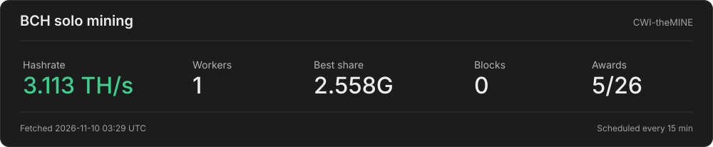

<picture>
  <source media="(max-width: 600px)" srcset="./assets/jj-header-mobile.svg"/>
  
</picture>

# Hey, I'm JJ 👋

**Computer engineer · AI researcher · Builder**

From operating systems and hardware to AI-powered products. 
I like understanding the whole stack — and building across it.

  
  
  

[About](#about) &nbsp; · &nbsp; [Focus](#focus) &nbsp; · &nbsp; [Stack](#stack) &nbsp; · &nbsp; [Activity](#activity) &nbsp; · &nbsp; [Blockchain](#blockchain) &nbsp; · &nbsp; [Mining lab](#mining-lab)

## About

| | Currently |
| :--- | :--- |
| **🚀 Building** | **Chief Agentic Officer, FixAiFlow** — AI-native software and agentic workflows |
| **🎓 Studying** | **M.S. Electrical & Computer Engineering** — University of Illinois Urbana-Champaign |
| **🧑‍🏫 Teaching** | **ECE 391 Teaching Assistant** — Operating Systems |

## Focus

<table>
  <tr>
    <td width="33%" valign="top">
      <h3>🧠 Agentic AI</h3>
      
AI products and intelligent automation.

      
Autonomous software engineering, AI security, robustness, and efficient GPU inference.

    </td>
    <td width="33%" valign="top">
      <h3>⚙️ Systems</h3>
      
Software that understands the hardware.

      
RISC-V, operating systems, memory management, concurrency, device drivers, and performance.

    </td>
    <td width="33%" valign="top">
      <h3>⛓️ Blockchain</h3>
      
Protocols, cryptography, and physical compute.

      
BTC / BCH solo mining, Bitaxe ASICs, and reinforcement learning for energy-efficient mining.

    </td>
  </tr>
</table>

## Stack

<h3>Languages</h3>

  
  &nbsp;&nbsp;
  
  &nbsp;&nbsp;
  
  &nbsp;&nbsp;
  
  &nbsp;&nbsp;
  
  &nbsp;&nbsp;
  
  &nbsp;&nbsp;
  

C &nbsp; · &nbsp; C++ &nbsp; · &nbsp; Python &nbsp; · &nbsp; Bash &nbsp; · &nbsp; Java &nbsp; · &nbsp; Swift &nbsp; · &nbsp; JavaScript

 

<h3>Frameworks</h3>

  
  &nbsp;&nbsp;
  
  &nbsp;&nbsp;
  
  &nbsp;&nbsp;
  
  &nbsp;&nbsp;
  

PyTorch &nbsp; · &nbsp; TensorFlow &nbsp; · &nbsp; React &nbsp; · &nbsp; Angular &nbsp; · &nbsp; Spring

 

<h3>Infrastructure</h3>

  
  &nbsp;&nbsp;
  
  &nbsp;&nbsp;
  
  &nbsp;&nbsp;
  
  &nbsp;&nbsp;
  

Linux &nbsp; · &nbsp; Docker &nbsp; · &nbsp; AWS &nbsp; · &nbsp; Git &nbsp; · &nbsp; GitHub

## Activity

<samp>CODE · COMMITS · CONSISTENCY</samp>

  

<samp>BUILDING WITH AI</samp>

AI-assisted coding activity tracked by Tokscale.

## Blockchain

A view of the networks behind the experiments.

<samp>MARKET PULSE · BTC / ETH / BCH</samp>

  
  
  

  
  

Market data from <a href="https://chainregistry.net/widgets">ChainRegistry</a> · Bitcoin network data from <a href="https://mempool.space/">mempool.space</a>

## Mining lab

<b>Bitaxe Gamma · BCH · SHA-256d · Solo mining</b>

<a href="https://cwi-themine.com/solo-bch-sha256d/address/bitcoincash:qrkyk3usu33mnzl0luxs8z5crdlus5p5zscpc27v70">
  <picture>
    <source media="(max-width: 600px)" srcset="./assets/mining-telemetry-mobile.svg"/>
    
  </picture>
</a>

Pool telemetry · Scheduled every 15 minutes · The card shows the last successful fetch. GitHub scheduling and image caching can delay updates. Click to open the current pool dashboard.

---

### Let's build something ambitious.

AI research · Product work · Systems engineering · AI security · Blockchain

**[Connect on LinkedIn →](https://www.linkedin.com/in/jiwoong3/)**

 

<samp>BUILD. EXPERIMENT. LEARN. REPEAT.</samp>

  

